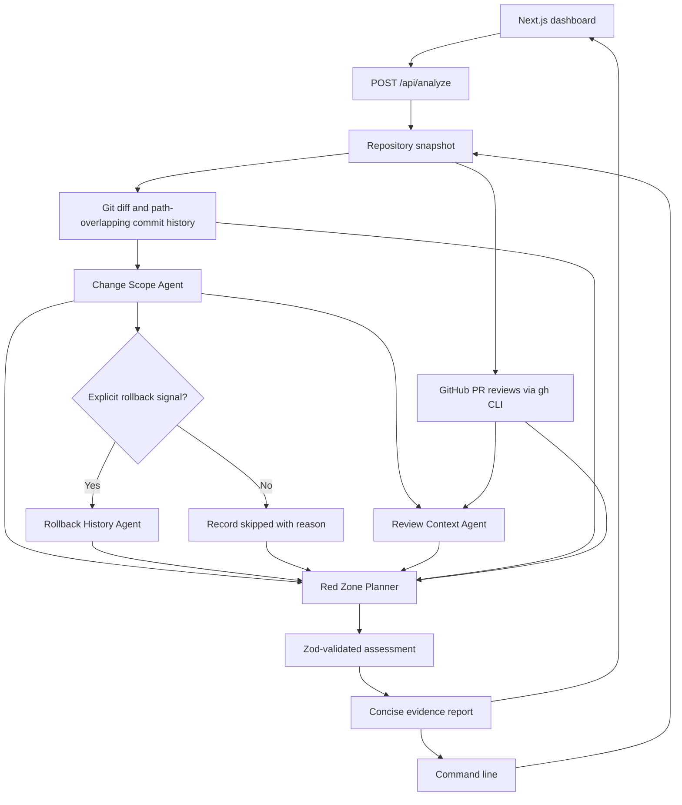

# Red Zone Agent

Red Zone looks for historical risk signals related to the code being changed. It compares a candidate diff with prior commits and GitHub review evidence, then produces a concise assessment with links to the supporting evidence.

## Architecture

### Request and evidence flow

1. The dashboard API or CLI calls `collectRepositorySnapshot` in `src/history.ts`.
2. The snapshot compares the selected base with the merge base and `HEAD`, and includes staged and unstaged changes to tracked files. Untracked files are currently excluded.
3. The collector gathers up to 40 earlier commits that touched the changed paths. It supplies commit hashes, dates, subjects, and paths, not commit bodies.
4. `collectReviewEvidence` in `src/github.ts` uses the GitHub CLI (`gh`) to find prior PR reviews and comments for overlapping changed paths when `GH_REPO` is configured.
5. `analyzeSnapshot` runs the specialist agents and passes their findings, the candidate diff, and the original evidence to the planner.
6. The planner returns a structured assessment. The application filters cited commit hashes and review IDs against the evidence it actually received, then `src/report.ts` renders a concise report.

### Agents

- **Change Scope Agent** reads the candidate diff and describes the affected behavior, files, and functions. It does not decide risk.
- **Rollback History Agent** runs only when a changed-path commit subject explicitly begins with a supported signal such as `Revert`, `rollback`, `roll back`, `feature flag`, or `kill switch`. If no signal is present, the report records that it was skipped. The current collector does not inspect source history for feature-flag code changes.
- **Review Context Agent** checks supplied GitHub comments and review decisions, treating them as review evidence rather than proof of a production incident.
- **Red Zone Planner** synthesizes the specialist findings with the original evidence and produces the final risk level, rationale, citations, and follow-up questions.

The dashboard shows each specialist’s status and a short finding. It does not display private model chain-of-thought.

## Stack

- Next.js dashboard and API routes
- Mastra agents for the planner and specialists
- OpenAI models through the Mastra OpenAI model integration; defaults to `gpt-4o-mini`
- Zod structured output for the final assessment
- Git for candidate diffs and history; GitHub CLI for PR review evidence

## Run locally

1. Install dependencies with `npm install`.
2. Copy `.env.example` to `.env` and set `OPENAI_API_KEY`. Set `GH_REPO` to `owner/repository` and authenticate `gh` if you want GitHub review evidence. Google OAuth variables are optional for local development.
3. Start the dashboard with `npm run dev` and open `http://localhost:3000`.
4. Choose a base branch such as `main` and run an analysis. Tracked local edits are included alongside committed branch changes.

To run from the terminal, use `npm run analyze -- main`. Add `--json` to print the structured analysis and its evidence.

## Current limits

- The rollback gate uses commit subjects and paths. It does not inspect commit bodies, code-level feature-flag changes, incident records, telemetry, or deployment history.
- Commit history is limited to 40 commits that touch the candidate paths; GitHub search is limited by `REDZONE_PR_LIMIT` and may not include older relevant PRs.
- Untracked files are excluded from model input.
- File overlap is a candidate signal, not proof that two changes affect the same function or behavior.
- Historical review concerns and a revert are not, by themselves, proof of a production incident or its cause.
- The analyzer reports evidence and risk; it does not modify source code or make merge decisions.
