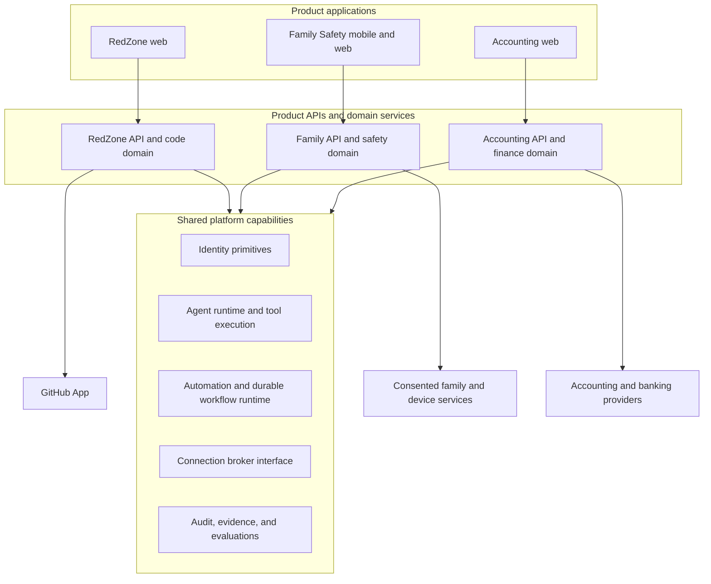

# Product Platform Architecture

## Purpose and scope

This document describes a proposed shared platform for three products:

- **RedZone** — developer tooling for code review, repository risk, and engineering workflows.
- **Family Safety** — a consumer product for family coordination and safety.
- **Accounting** — a business product for accounting workflows such as reconciliation and invoice review.

The products can share infrastructure where it is useful, while keeping separate product experiences, data, permissions, and domain behavior. This is a target architecture for exploration; it does not describe the current implementation of the GCU repository or RedZone.

## Design principles

1. **Separate identity from access to external systems.** Sign-in establishes who a person is. A connection grants a product scoped access to a provider such as GitHub or an accounting system.
2. **Keep product data and authority isolated.** Each product owns its domain model, policies, tools, and customer data.
3. **Make automation explicit and inspectable.** Every run should expose its trigger, steps, evidence, approvals, actions, and outcome.
4. **Use agents for judgment, workflows for control.** Agents can interpret evidence or propose actions. The workflow owns sequencing, retries, approvals, and final authorization.
5. **Require human approval for consequential actions.** An agent proposal does not itself authorize payments, accounting changes, or sensitive family actions.
6. **Extract shared capabilities from real use.** Start with product needs and promote a capability to the shared platform when more than one product benefits from it.

## High-level architecture



The shared capabilities are infrastructure. Product APIs remain responsible for enforcing their own tenant boundaries and domain rules before calling those capabilities.

## Core concepts

### Product and tenant

A **product** defines a user experience and domain boundary. A **tenant** is the customer-owned workspace within a product: for example, an engineering organization in RedZone, a household in Family Safety, or a business in Accounting.

Tenant identifiers should be scoped to a product. Do not assume that a household and a business share membership, permissions, or data just because the same person uses both products.

### Identity, membership, and roles

An **identity** represents an authenticated person. An identity provider proves who signed in; it does not by itself grant access to a tenant or provider data.

**Membership** links an identity to a tenant. **Roles and policies** determine what that member can do there, such as configure an automation, manage a connection, or approve a proposed action.

Initial sign-in choices can be product-specific:

- RedZone can start with GitHub sign-in for developer onboarding, with organization-oriented SSO considered later.
- Family Safety can support Apple and Google sign-in for consumer onboarding.
- Accounting can support work identity providers and roles appropriate to businesses or accounting firms.

These are product decisions, not a requirement that all products use the same login provider.

### Connection

A **connection** is an authorized relationship between a tenant and an external provider. It should record provider and tenant identity, granted scopes, connection status, and lifecycle metadata. Provider secrets and access tokens must be handled server-side and must not be exposed to clients or agent prompts.

Examples include:

- A GitHub App installation granting RedZone access to selected repositories.
- A family member opting into a supported family or device service.
- A business connecting an accounting provider or bank feed.

Connections are independent of sign-in. A user may authenticate with GitHub while RedZone separately uses a GitHub App installation to access repositories.

For portability, product code should depend on an internal connection interface. Provider-specific adapters can use Vercel Connect or another broker. Vercel Connect is a useful integration option, not a required platform dependency.

### Agent, tool, and policy

An **agent** is a domain-specific reasoning component. It receives only the context needed for its task and can request approved tools.

A **tool** is a bounded operation, such as reading a pull request, preparing a reconciliation, or sending an approved notification. A **policy** checks the tenant, member or run authority, connection scopes, and action risk before a tool executes.

Share the runtime and tool execution patterns where useful, but keep product-specific agents, tool registries, prompts, and authorization policies separate. A shared runtime does not mean shared access to product data.

### Automation and run

An **automation** is a configured workflow definition. A **run** is one execution of that definition.

An automation can contain deterministic steps, agent steps, waits, approval gates, and actions. The workflow runtime controls state transitions, retries, timeouts, and resumptions. Each run should preserve enough input references and outputs to explain what happened without copying unrelated tenant data into a shared context.

```text
Trigger → gather evidence → agent analysis → optional approval
        → authorized action → outcome and audit record
```

An agent can recommend an action; the workflow and policy layer decide whether the action is allowed and whether a person must approve it.

### Approval, evidence, and audit

An **approval** is a durable human decision tied to a specific proposed action and the evidence available at decision time. It records who decided, what they approved or rejected, and when.

**Evidence** links a conclusion to the source records that support it. **Audit** records important system and human events, including connection changes, automation configuration, approvals, and external actions.

### Evaluation

**Evaluation** measures whether agents and automations behave as intended. Product teams should maintain representative cases and assess quality, including incorrect findings, missed risks, policy violations, and unnecessary escalations. Evaluation data must respect each product's privacy and access boundaries.

## Product boundaries and examples

| Concern | RedZone | Family Safety | Accounting |
|---|---|---|---|
| Tenant | Engineering organization | Household | Business or accounting firm |
| Typical connection | GitHub App installation | Explicitly consented family/device service | Accounting provider or bank feed |
| Example automation | Identify a risky PR change and request maintainer review | Notify an opted-in family member about an event | Detect a transaction mismatch and prepare reconciliation |
| Sensitive action | Merge or modify repository state | Share location or initiate an escalation | Post entries, send payments, or file records |
| Initial authority | Read and recommend; approval for writes | Respect member consent and product policy | Read and prepare; approval before consequential writes |

The same workflow machinery can run these examples, but their tools, data, consent rules, and approval policies must remain product-specific.

## Mobile implications

Family Safety is the likely first product that needs a native mobile experience because location, push notifications, and low-connectivity behavior can be central to its user value. A mobile client should call authenticated product APIs; provider credentials and agent tool execution stay on the server.

Native OAuth should use the system browser and PKCE. Mobile also requires deliberate handling of deep links, secure local session storage, permissions, background execution, battery use, and notification preferences. Location access should be explicit, visible, revocable, and limited to the feature the member enabled.

RedZone can remain web-first unless a concrete mobile workflow justifies a companion app. Accounting can begin with a web experience and add mobile for focused approval or notification flows if users need them.

## Security and trust boundaries

- Authenticate users, then authorize every operation against product, tenant, membership, and role.
- Keep provider tokens out of browsers, mobile apps, logs, prompts, and model-visible context unless a narrowly scoped representation is required.
- Give tools the minimum required provider scopes and expose narrow actions instead of arbitrary credentials.
- Treat model output as untrusted proposals. Validate structured inputs and outputs, then enforce policy in deterministic code.
- Require explicit approval for high-impact or difficult-to-reverse actions.
- Keep tenant data, vector indexes, caches, evaluations, and audit records appropriately isolated by product and tenant.
- Provide connection revocation and define what data is retained or deleted when a connection or tenant is removed.

## Suggested implementation sequence

1. Keep RedZone as the first proving ground for automation runs, approvals, evidence, audit, and one external connection.
2. Define product-scoped identity, tenant, membership, and connection interfaces before adding a second product.
3. Extract shared runtime or workflow code only after a second real use case confirms the abstraction.
4. Prototype one read-only Accounting automation and one consent-focused Family Safety flow to test whether the boundaries hold.
5. Add write-capable tools behind explicit policy and approval, with evaluations covering both normal and failure cases.

This sequence supports learning and a credible prototype without committing all products to one identity provider, one hosting provider, or one agent framework.
